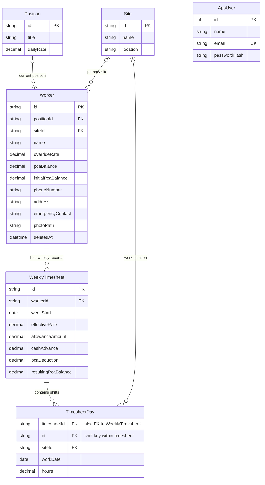

# Data Architecture & Persistence Layer

The application stores payroll and worker records in one MySQL database, accessed directly through PHP PDO rather than an ORM. Its six tables cover the administrator, positions, work sites, workers, weekly payroll summaries, and individual work entries.

## Requirements Analysis and Conceptual Modeling

### Problem scope and users

AMR Payroll replaces manual worker and weekly payroll recordkeeping with a single-administrator application. Its intended user is the payroll administrator, who maintains worker profiles, positions and sites, records hours by day and work site, and reviews weekly payroll amounts and removed workers.

The system includes worker and position/site assignments, soft removal of workers, weekly timesheets, allowances, cash advances, PCA balances and deductions, and administrator authentication. Attendance currently stores total hours per date and site, not clock-in/out timestamps or break durations. It does not model multiple administrators, roles, departments, individual allowance/advance transactions, or a separate audit log.

### Business rules and constraints

| Rule | Enforcement and design consequence |
|---|---|
| At most one administrator account exists. | `app_users.id` is constrained to `1`; setup inserts that key and registration is disabled. |
| A worker can have no current position or primary site. | `workers.position_id` and `workers.site_id` are nullable foreign keys. |
| A worker can have at most one weekly timesheet per week. | `uq_worker_week` makes `(worker_id, week_start)` unique. |
| A timesheet week runs Sunday through Saturday, with dated special/makeup work also supported. | The API validates a Sunday week start and each attendance date; a dated entry may be outside the regular seven-day range. |
| Attendance hours are entered by work date and site; multiple entries and sites on the same date are allowed. | `timesheet_days` stores each entry separately from its weekly payroll summary. Eight hours equals one payable day unit. |
| Gross labor pay is payable day units multiplied by the effective daily rate. | The API derives day units from hours divided by eight and uses the rate snapshot saved on the weekly timesheet. |
| The effective daily rate is the worker override when present, otherwise the position daily rate. | `workers.override_rate` is optional; the applied rate is snapshotted as `weekly_timesheets.effective_rate`. |
| A positive allowance requires a category and descriptive note; a new PCA loan requires a reason. | The API validates these details before persisting the weekly record. |
| Site labor cost follows the actual attendance allocations. | The interface allocates gross labor by each day's site, hours divided by eight, and the saved daily rate. |
| Removing a worker preserves payroll history. | Worker removal is soft deletion using `deleted_at`; timesheet-to-worker deletion is restricted. |
| Referenced positions and sites cannot be physically deleted. | Foreign keys use `ON DELETE RESTRICT`. |
| Net pay is calculated from total hours divided by eight, multiplied by the effective daily rate, plus allowance, less cash advance and PCA deduction. | The API derives `totalPay` from the saved day entries and weekly payroll inputs; it is not duplicated as a database column. |
| The current PCA balance and opening balance are retained on the worker record. | `pca_balance` and `initial_pca_balance` are stored separately; timesheets also store resulting balance snapshots. |
| Allowance type is either Gas, Load, Others, or absent. | `weekly_timesheets.allowance_type` uses a MySQL `ENUM`. |
| Payroll amounts and hours must be non-negative through the application. | The API validates incoming amounts; the DDL has no corresponding non-negative `CHECK` constraints. |

### Workload and reporting

The expected workload is administrator-maintained and modest in transaction volume; the repository contains no measurements to quantify it. The API saves collections of positions, sites, workers, and payroll records in a database transaction, upserts existing rows, and removes omitted position/site/timesheet rows. Reads load the application data collections, and the interface filters and aggregates weekly pay, hours, advances, PCA deductions, and allowances.

Likely operational queries include worker lookup by name or removal status, timesheets by week, payroll history by worker, and work entries by site/date. Reporting is primarily weekly payroll totals and per-worker history, with site labor costs derived from attendance hours and daily rate snapshots. The schema indexes worker names, worker removal timestamps, week start dates, and timesheet-day parent/date and site/date pairs. No measured transaction rates, formal reporting workload, or database-side aggregate reporting is documented in the repository.

## Database Configuration

| Service/Module | DB Type | Profile | Driver | Connection | Migration Tool |
|---|---|---|---|---|---|
| AMR Payroll PHP application | MySQL 8.0+ or compatible MySQL | Local development and application runtime use MySQL; no separate database profiles are defined | PHP PDO MySQL | Defaults to `127.0.0.1:3306`, database `amr_payroll`; credentials are configurable through environment variables | No versioned migration framework. `schema.sql` creates the current schema; SQL scripts add authentication or migrate existing weekday-column timesheets. |

InnoDB provides transactional writes and foreign-key enforcement. The DDL is authoritative; there is no ORM schema generation, test database profile, or automatic seed-data script. Administrator setup occurs through the application. Uploaded worker images are stored as files under `uploads/`; the database stores their paths, not their binary contents. Connection defaults and setup instructions are in [README.md](../../../../../README.md).

## Data Ownership per Service

| Service | Tables Owned | ORM Framework | Caching | Notes |
|---|---|---|---|---|
| AMR Payroll PHP application | `app_users`, `positions`, `sites`, `workers`, `weekly_timesheets`, `timesheet_days` | None; prepared SQL through PDO | None detected | One application and one shared database. Authentication SQL is in `auth.php`; payroll and reference-data SQL is in `api.php`. |

## Entity Model

The administrator, position, site, worker, and weekly-timesheet summary are strong entities with their own primary keys. `TimesheetDay` is a weak entity: it is identified by its parent timesheet and a shift discriminator, and has no independent lifecycle.

The model has no generalization/specialization hierarchy. A worker's position and primary site are optional single-valued references. Each weekly timesheet belongs to one worker and contains zero or more dated work entries. An entry can reference one work site; multiple entries may share the same date, including different sites or shifts.

<!-- mermaid-checked: every attribute is `<type> <name> [<key>] ["<description>"]` with at most one of PK/FK/UK, no \n in descriptions, no {} in descriptions, every relationship label is double-quoted -->

### Implemented relational schema and keys

| Relation | Primary key | Candidate/alternate keys | Important attributes and constraints |
|---|---|---|---|
| `positions` | `id` | None declared | `title`, `daily_rate`; titles are not unique in the DDL. |
| `sites` | `id` | None declared | `name`, `location`; names are not unique in the DDL. |
| `workers` | `id` | None declared | Nullable `position_id` and `site_id`; personal/contact details; optional `override_rate`; opening/current PCA values; soft-removal fields. |
| `weekly_timesheets` | `id` | `(worker_id, week_start)` | Weekly payroll inputs and PCA/rate snapshots; net pay is derived from its shift rows. |
| `timesheet_days` | `(timesheet_id, id)` | None declared | A single dated attendance-hours/site entry; multiple rows may share a date. |
| `app_users` | `id` | `email` | `CHECK (id = 1)` limits the table to the single administrator identifier. |

IDs are application-supplied strings for business records. Names and phone numbers are not declared candidate keys and must not be assumed unique. The timesheet's unique worker/week key prevents duplicate weekly records even when its primary key differs.

### Referential integrity and delete behavior

| Foreign key | On update | On delete | Rationale |
|---|---|---|---|
| `workers.position_id` -> `positions.id` | `CASCADE` | `RESTRICT` | Keep assignments valid when an identifier changes; do not remove a referenced position. |
| `workers.site_id` -> `sites.id` | `CASCADE` | `RESTRICT` | Keep primary site assignments valid; do not remove a referenced site. |
| `weekly_timesheets.worker_id` -> `workers.id` | `CASCADE` | `RESTRICT` | Preserve payroll history and its worker reference. |
| `timesheet_days.timesheet_id` -> `weekly_timesheets.id` | `CASCADE` | `CASCADE` | A shift has no meaning without its weekly summary and is deleted with that summary. |
| `timesheet_days.site_id` -> `sites.id` | `CASCADE` | `RESTRICT` | Preserve historical work-site references. |

The application uses a transaction for a multi-table save, prepared statements for data values, and `INSERT ... ON DUPLICATE KEY UPDATE` for upserts. Shift entries are replaced with the submitted entries in the same transaction as their weekly summary, and deleting a weekly summary cascades to its shifts. Removal from the interface is generally a soft delete for workers. Position, site, and timesheet collections are synchronized by deleting rows omitted from the submitted collection; foreign-key restrictions protect referenced data. The API catches database exceptions and returns an error response.

## Key Repository Methods

There are no repository interfaces or ORM entities. Data access is implemented directly in PHP using PDO.

| Service | Repository / source | Notable methods or queries | Purpose |
|---|---|---|---|
| AMR Payroll | `api.php` | `save_data(PDO $pdo, array $payload)`; prepared upserts to reference data, workers, and `weekly_timesheets`, plus transactional replacement of `timesheet_days` | Persist the submitted application state in one transaction. |
| AMR Payroll | `api.php` | `delete_missing(PDO $pdo, string $table, array $ids)` | Remove omitted site, position, or weekly timesheet rows while relying on foreign keys to reject unsafe deletes. |
| AMR Payroll | `api.php` | `SELECT` workers ordered by name; positions and sites ordered by label; timesheets ordered by week with related dated shift rows | Load data for the authenticated payroll interface; calculate net pay from the saved shifts and weekly inputs. |
| AMR Payroll authentication | `auth.php` | Count `app_users`; select administrator by ID or email; insert the first administrator | Check setup state and authenticate the single administrator. |

The code uses no stored procedures, ORM-derived queries, or explicit database-side reporting repository. Payroll summary calculations are performed in the application.

## Caching Strategy

No application cache, query-result cache, Redis, or ORM second-level cache is configured. API responses set `Cache-Control: no-store`; each authenticated page load retrieves current records from MySQL. This is appropriate for the observed small, administrator-driven workload and avoids stale payroll values. Worker image files are stored separately, but this is file storage rather than a data cache.

## Data Ownership Boundaries

All persistent business data is owned by one PHP application and stored in one MySQL database; the repository contains no other service, isolated database, or cross-service data access. The API and authentication module access their respective tables directly using PDO. There is no CQRS/read model or service-to-service aggregation. The UI computes summary totals from the records loaded by the API.

The schema separates position and site reference data from worker, shift, and weekly payroll records, reducing duplication of position rates and site descriptions. Weekly summaries retain an `effective_rate` and PCA result snapshots so historical payroll values are not silently changed when current worker or position data changes. The API calculates net pay from shift hours and payroll inputs rather than storing a duplicate total.

### Data Classification & Sensitivity

| Entity | Sensitive Fields | Classification | Controls in Place |
|---|---|---|---|
| `workers` | `name`, `phone_number`, `address`, `emergency_contact`, `photo_path` | PII | API requires an authenticated administrator; no field-level encryption or data masking is configured in the schema. Photo bytes are stored in the uploads directory. |
| `app_users` | `name`, `email`, `password_hash` | PII and authentication data | Passwords are stored as password hashes; authentication is administrator-only. No field-level encryption or masking is configured in the schema. |
| `weekly_timesheets` | `worker_id`, pay inputs, advances, PCA balances and deductions | Employment and financial data | API access requires an authenticated administrator; net pay is derived rather than stored; no field-level encryption or masking is configured in the schema. |
| `timesheet_days` | `timesheet_id`, `work_date`, `hours`, `site_id` | Employment data | API access requires an authenticated administrator; no field-level encryption or masking is configured in the schema. |
| `positions`, `sites` | Position title, site name and location | Business data; a location may be sensitive depending on use | No field-level encryption or masking is configured in the schema. |

No payment-card data (PCI) or health data (PHI) is represented by the current entity model.

## Relational Schema Design and Normalization

### Starting unnormalized form

A paper/spreadsheet-style payroll record can combine worker name, contact details, position title/rate, site name/location, a week, seven weekday hours and sites, additional-day hours/site, and payroll amounts in one record. Repeating worker, position, and site descriptions across weeks creates update anomalies. Storing multiple days or sites as a list in one cell would also violate first normal form.

For example, the flat record can be represented as `PayrollFlat(worker_id, worker_name, position_id, position_title, daily_rate, site_id, site_name, week_start, sunday_hours, ..., saturday_hours, sunday_site_id, ..., saturday_site_id, allowance, advance, deduction, total_pay)`. Its natural identification is the worker and week, but worker, position, and site facts are repeated in payroll rows.

### 1NF

Make every stored value atomic and give each record a key. The former weekly table stored separate scalar hours and site columns for each weekday, plus an optional "other day" entry. Although values were atomic, the repeated day columns made new shifts and flexible site assignments awkward. The current design moves every shift into its own `timesheet_days` row, identified by `(timesheet_id, id)`, with one date, hours value, and optional site.

### 2NF

In a flat payroll record, worker name/contact depend only on the worker, position title/rate only on the position, site name/location only on the site, and each shift fact on the weekly record and its shift discriminator. Separate `workers`, `positions`, `sites`, `weekly_timesheets`, and `timesheet_days` so non-key attributes depend on the whole key of their relation. The weekly summary has candidate key `(worker_id, week_start)` in addition to `id`.

### Functional and multivalued dependencies

The following functional dependencies describe the identifiers and business keys in the implemented schema:

| Relation / scope | Functional dependency |
|---|---|
| `positions` | `id -> title, daily_rate, created_at, updated_at` |
| `sites` | `id -> name, location, created_at, updated_at` |
| `workers` | `id -> name, position_id, site_id, override_rate, pca_balance, initial_pca_balance, contact and removal attributes` |
| `weekly_timesheets` | `id -> worker_id, week_start, payroll attributes`; `(worker_id, week_start) -> id and payroll attributes` |
| `timesheet_days` | `(timesheet_id, id) -> work_date, hours, site_id` |
| `app_users` | `id -> name, email, password_hash, created_at`; `email -> id, name, password_hash, created_at` |

In the flat input, worker, position, and site attributes depend on only part of the worker/week key, causing partial dependencies; their separate relations remove these. Every listed determinant is a candidate key of its relation. In particular, `(timesheet_id, id)` is the complete key for a shift and permits more than one shift on the same date. Net pay is calculated from shift hours and weekly payroll inputs and is not stored as a second independently writable value.

The timesheet has a multivalued set of work shifts, but date, hours, and site are attributes of the same shift rather than independent multi-valued facts. `timesheet_days` stores each complete shift under its own key, so independent hour and site lists are never combined into spurious pairs. No non-trivial MVD with a non-superkey determinant is identified in the decomposed relations; they satisfy 4NF for the facts currently modeled.

### 3NF

Remove transitive descriptive dependencies: a worker stores `position_id`, not the position title/rate; a shift stores `site_id`, not the site name/location. This is reflected in the foreign keys. `effective_rate` and `resulting_pca_balance` remain weekly snapshots so later changes to worker/position data do not rewrite historical payroll inputs.

### BCNF and 4NF analysis

For each implemented relation, every non-trivial functional dependency has a candidate key as its determinant: `position_id -> title, daily_rate`, `site_id -> name, location`, `worker_id -> worker attributes`, `timesheet_id -> weekly attributes`, `(worker_id, week_start) -> weekly attributes`, `(timesheet_id, id) -> shift attributes`, and `app_users.id` / `app_users.email` -> account attributes. Under these declared dependencies, the relations satisfy BCNF. `totalPay` is derived when the API reads data, so it does not introduce a non-key determinant or update anomaly in the stored schema.

The old-to-new decomposition replaces the repeating weekday and extra-day columns with the weak child relation `timesheet_days(timesheet_id, id, work_date, hours, site_id)`. `id` is a shift discriminator scoped to its weekly timesheet; using the date alone as a key would incorrectly prevent multiple shifts on the same date. This reduces schema changes when adding dates or shifts and keeps each shift's hours and site associated. The API derives net pay from its source values. A future PCA ledger could remove the remaining current-balance/snapshot duplication, but that is outside this timesheet normalization change.

## References to implementation

- [schema.sql](../../../../../schema.sql) - current MySQL tables, keys, indexes, and foreign keys.
- [migration_auth.sql](../../../../../migration_auth.sql) - administrator table migration for existing databases.
- [migration_timesheet_days.sql](../../../../../migration_timesheet_days.sql) - additive backfill from weekday columns to shift rows.
- [migration_sunday_week_start.sql](../../../../../migration_sunday_week_start.sql) - converts existing normalized Monday-start payroll records to Sunday starts.
- [migration_timesheet_days_cleanup.sql](../../../../../migration_timesheet_days_cleanup.sql) - remove legacy weekday/pay-total columns after verification.
- [config.php](../../../../../config.php) - PDO MySQL connection setup.
- [api.php](../../../../../api.php) - payroll/reference-data reads, transactional writes, and collection synchronization.
- [auth.php](../../../../../auth.php) - single-administrator setup and authentication persistence.
